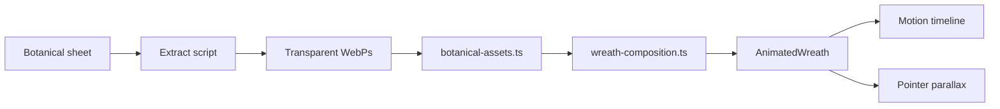

# The Trendy Wreath House Homepage

The workspace is an empty git repo ([README.md](README.md) only). This phase scaffolds the app and implements the homepage only. No extra routes, auth, CMS, database, or checkout.

Creative reference is the restraint of [jluxholidays.com](https://jluxholidays.com/) — editorial type, full-bleed photography, quiet luxury — with a separate identity: warm black, antique gold used like jewelry, ivory breathing room, and a wreath that assembles itself.

## Stack

Scaffold in the existing directory with `create-next-app` (TypeScript, App Router, Tailwind, ESLint, `src/`, `@/*`):

- Next.js 16.4.6, React strict
- Tailwind CSS 4.3.5, theme tokens in [src/app/globals.css](src/app/globals.css) via `@theme` (no extra config file unless the scaffold creates one)
- `motion` 14.14.0 (`motion/react`) for the timeline and scroll motion. No GSAP. No `framer-motion` duplicate.
- `lucide-react` only if a control truly needs an icon (menu, close, lightbox). Navigation and process steps stay typographic.
- `next/font`: Cormorant Garamond (headlines, italics) and Jost (UI, body, labels)
- `clsx` and `tailwind-merge` in [src/lib/utils.ts](src/lib/utils.ts)

Aceternity is used twice, copied into [src/components/ui](src/components/ui) and restyled to this palette. Defaults (purple glow, rounded cards, gradient text) are not kept.

- Text Generate Effect, once, on the signature headline
- A small parallax image treatment inside the signature section

The wreath is bespoke. It does not use an Aceternity animation.

## Design system

Tokens:

- `#0C0C0C` ink, `#171614` charcoal, `#B89B5E` antique gold, `#DCC69C` champagne, `#F6F2E9` ivory, `#A7A29A` muted
- Gold is limited to a 1px rule, an eyebrow, a link underline, focus rings, and the wordmark accent
- Type scale uses `clamp()`. Headlines break on purpose. Labels are small, uppercase, wide tracking.
- Radius stays near zero. No glass, blobs, pills, or three-up icon cards.
- Motion: one ease `[0.22, 1, 0.36, 1]`, reveals 0.8–1.1s, hovers under 0.4s. Content is in the DOM and readable before JS runs. `prefers-reduced-motion` skips travel and shows final states.

## Botanical assets

The attached sheet is a sprite of real cutouts on black, with yellow, red, and white fringe. It is not production-clean and will not be used as one image.

A one-off script, [scripts/extract-botanicals.mjs](scripts/extract-botanicals.mjs) (sharp), will:

- Key out near-black
- Suppress the colored fringe and white halo
- Split the sheet on whitespace into transparent WebPs under [public/images/botanicals](public/images/botanicals)
- Write [src/data/botanical-assets.ts](src/data/botanical-assets.ts) with id, file, category, and intrinsic size

Expected library, about 16 files: three ivory roses, two hydrangeas, two champagne blooms, three eucalyptus sprigs, gold berries, gold leaves, two filler clusters, grapevine base, champagne ribbon. If automatic splits merge neighbors, the script falls back to fixed crop boxes taken from the sheet.

[src/data/wreath-composition.ts](src/data/wreath-composition.ts) places roughly 32 layers by reusing that library. Each layer has id, asset id, category, start and end position, start and end rotation, scale, width, z-index, delay, duration, and parallax depth. Coordinates are 0–1000 in a square stage so the wreath scales as one object.

Art direction, not a perfect circle: grapevine base centered with a clear opening; hydrangea weight upper left; roses at 11, 1, and 4 o’clock; champagne blooms on the right; eucalyptus sweeping the lower half; gold sprigs at the sides; filler tucked under blooms; ribbon entering from lower right and crossing the base. Sizes and rotations differ so clusters feel hand-placed.

Every asset record includes `placeholder: true` until a cleaner studio cutout replaces the file in the manifest. [README.md](README.md) will explain that swap: replace the WebP, keep the id, adjust width if the aspect ratio changes.

Gallery, collections, and the about portrait do not exist yet. Those sections will use still compositions built from the same cutouts on ink or ivory, flagged `placeholder: true` in data. No stock photos of doorways, no invented founder, no fake reviews, prices, or delivery promises. Copy stays in [src/data/site-content.ts](src/data/site-content.ts) so it can be replaced later without touching layout.

## Hero architecture

[src/components/home/Hero.tsx](src/components/home/Hero.tsx) is a server section: semantic header content on the left, wreath on the right, stacked on small screens with the wreath still large and the CTA in thumb reach. Headline and both links render immediately.

[src/components/home/AnimatedWreath.tsx](src/components/home/AnimatedWreath.tsx) is the only heavy client piece.

Choreography uses Motion keyframes (a bowed midpoint, then the final point) so paths arc without GSAP:

- 0–0.8s: type reveals; pieces appear scattered, low opacity
- 0.6–1.8s: base and greenery settle the silhouette
- 1.2–3s: flowers travel in alternating clusters
- 2.8–4s: gold accents and ribbon finish
- After that the wreath stays assembled. Desktop pointer parallax shifts layers a few pixels by depth. No loop, no bounce.

Hydration: the server and first client render share the same start classes. A CSS `prefers-reduced-motion` rule pins layers to their final transform and full opacity before paint. JS reads that media query in `useEffect` and only then plays the timeline, so reduced-motion users never see a disassembly. Unique files are preloaded; `next/image` is not required inside the absolutely positioned stage if it fights the animation, but each layer still gets explicit width, height, and alt text. The stage is `aria-hidden` because it is decorative; the headline carries the meaning.

On small screens, filler duplicates marked `desktopOnly` drop out. The base, ribbon, and primary blooms stay. Parallax turns off.

## Page composition

Each section changes structure. Shared pieces live in [src/components/motion](src/components/motion): a masked line reveal and an image reveal, both once-on-scroll and disabled when motion is reduced.

- Nav, [src/components/layout/Navbar.tsx](src/components/layout/Navbar.tsx). Wordmark, anchors for Home, About, Collections, Gallery, How It Works, Contact, and an inquiry link. Transparent over the hero, solid `#0C0C0C` after the hero. Gold hairline underline on hover. Mobile menu is a full-viewport ivory or ink panel with large Cormorant links. Focus states visible. Escape and focus return implemented.
- Brand intro. Ivory. Asymmetric: oversized statement “More than a wreath. / A beautiful first impression.”, a narrow copy column, one botanical still, a single gold sprig. No stats.
- Collections. Horizontal scroll-snap panels on desktop (Spring & Summer, Autumn, Holiday, Everyday Elegance, Custom Designs), a vertical editorial stack on mobile. Titles over images. No prices. Keyboard can move the row.
- Signature experience. Near full-viewport charcoal field, large botanical still, type locked to the left third. Headline uses the adapted text-generate effect once: “Every season deserves / something beautiful.” Slow image reveal and slight parallax.
- How it works. Three oversized numbers on a thin gold rule, vertically staggered, not cards: 01 Find Your Inspiration, 02 Choose Your Style, 03 Make It Yours. Language stays noncommittal about delivery and rental.
- Gallery. Lookbook mosaic: one tall frame, one wide frame, two details. Hover is a slow scale inside an overflow mask. Click opens a dialog lightbox with alt text, focus trap, and Escape. Images marked as temporary studio stills.
- About. Split. If `portrait` is null, the media side is a composed still and a visible note that the founder photograph is awaiting the client. Copy does not invent biography: “Designed with intention. / Made to welcome.” plus a short brand paragraph from `site-content.ts`.
- Testimonials. Component and data shape exist (`quote`, `name`, `context`). [src/data/site-content.ts](src/data/site-content.ts) ships `testimonials: []`. The section returns null until real reviews are added. Nothing placeholder is shown.
- Inquiry. Closing campaign lockup: “Let something beautiful / welcome you home.” A real form (name, email, message) with labels, errors, and a submit handler that does not call a server. Confirmation copy states that sending is not connected yet. No fake success.
- Footer. Wordmark, anchor links, contact placeholders (`email`, `phone`, `instagram` as empty strings render as “Details coming soon”), copyright, policy labels that are text rather than dead links. A huge low-contrast “Wreath House” sits behind the footer.

[src/app/page.tsx](src/app/page.tsx) only composes these sections. [src/app/layout.tsx](src/app/layout.tsx) sets metadata, Open Graph, and a simple `public/og` still exported from the cleaned botanicals. One `h1` in the hero. Later sections start at `h2`.

## Verification

After implementation: `tsc --noEmit`, `eslint`, `next build`. Then browser-check the homepage at desktop and a narrow viewport: anchor nav, solid nav after scroll, mobile menu, wreath settles and does not loop, reduced-motion final state, lightbox keyboard path, inquiry form does not claim a submission, no horizontal overflow.

## Out of scope

Additional pages, CMS, mail delivery, analytics, pricing, and any claim about years in business, installation, or turnaround.
